  

  

---

## 👋 About Me

I'm a **BCA student at SSMRV Degree College, Bengaluru**, specializing in **Cloud Architecture and Cybersecurity**. My primary engineering focus is building a strong foundation in **Microsoft Azure** infrastructure, identity governance, and **Cloud Security**.

Rather than treating cloud services as black boxes, I focus on the security questions behind every deployment:

<table>
<tr>
<td width="50%" valign="top">

**🌐 Network & Workload Isolation**  
*How should cloud networks and workloads be separated?*  
Applied through segmented Azure VNets, public/private subnet design, restrictive NSG rules, and hardened Ubuntu/Nginx hosts.

</td>
<td width="50%" valign="top">

**🔐 Identity & Least-Privilege Access**  
*How do identities access resources without over-permissioning?*  
Applied through Microsoft Entra ID, security groups, scoped Azure RBAC assignments, and System-Assigned Managed Identities.

</td>
</tr>
<tr>
<td width="50%" valign="top">

**🗝️ Secret Hygiene & Zero Hardcoded Keys**  
*How should applications handle secrets safely?*  
Applied by centralizing secrets in Azure Key Vault and authenticating workloads via Managed Identity instead of static credentials.

</td>
<td width="50%" valign="top">

**🛡️ Early Misconfiguration Detection**  
*How can policy violations and threats be caught early?*  
Applied through Azure Policy guardrails, declarative Terraform configurations, and Checkov static security scans.

</td>
</tr>
</table>

> **My engineering approach:** *Learn the concept → Build the architecture → Test the security controls → Document the proof → Improve it.*

---

## 🧭 Current Learning Roadmap

<table>
<tr>
<td width="33%" valign="top">

### ☁️ Azure Foundations

- Azure compute & Linux workloads
- Virtual Networks (VNet) & subnets
- Network Security Groups (NSGs)
- SSH key-only authentication
- Cloud resource lifecycle & governance

</td>
<td width="33%" valign="top">

### 🔐 Identity & Access

- Microsoft Entra ID administration
- Azure Role-Based Access Control (RBAC)
- Authentication vs. authorization flows
- System-Assigned Managed Identities
- Least-privilege access enforcement

</td>
<td width="33%" valign="top">

### 🛡️ Cloud Security & IaC

- Defense-in-depth network design
- Azure Key Vault & secret handling
- Azure Policy & compliance guardrails
- Terraform & Checkov static scanning
- Zero Trust & STRIDE threat modelling

</td>
</tr>
</table>

<strong>📌 What I'm focusing on right now (Click to expand)</strong>

 

My immediate priorities are strengthening **Python scripting** and **Bash/PowerShell** automation, completing **AZ-900 (Azure Fundamentals)** and **GH-900 (GitHub Foundations)**, and advancing toward **AZ-104 (Azure Administrator)**—while connecting every concept to real cloud deployments in my flagship project, **Togetherly Azure Platform**.

---

## 🚀 Featured Projects

I use hands-on projects to solve practical infrastructure and security challenges, validate configurations, and document working proof—including architecture diagrams, portal/CLI verification, and troubleshooting notes.

<table>
<tr>
<td width="50%" valign="top">

<h3>☁️ <a href="https://github.com/Faizankhan-cyber/togetherly-azure-platform">Togetherly Azure Platform</a></h3>
<code>Flagship Cloud Engineering</code> · <code>V1 & V2 Completed</code>

Versioned enterprise-style Azure cloud engineering project hosting and securing the Togetherly Workforce application across documented milestones.

**Implemented Architecture**
- **V1 (Application Infrastructure):** Azure VNet & subnet segmentation, NSG perimeter rules, Ubuntu Linux VM, and Nginx reverse proxy hosting.
- **V2 (Identity & Governance):** System-Assigned Managed Identity, Azure Key Vault secret retrieval, least-privilege Azure RBAC, and Azure Policy guardrails.

</td>
<td width="50%" valign="top">

<h3>🔐 <a href="https://github.com/Faizankhan-cyber/microsoft-entra-id-azure-rbac-standalone">Entra ID & Azure RBAC Lab</a></h3>
<code>Identity & Access Management</code> · <code>Terraform + Checkov</code>

Hands-on IAM and Infrastructure-as-Code lab built around repeatable identity provisioning and automated static policy checks, applying SC-900 security principles.

**Implemented Architecture**
- Provisioning Microsoft Entra ID test users and security groups
- Group-based, least-privilege Azure RBAC role assignments
- Declarative infrastructure authored in **Terraform (HCL)**
- Automated security misconfiguration scanning with **Checkov**

</td>
</tr>
<tr>
<td width="50%" valign="top">

<h3>👥 <a href="https://github.com/Faizankhan-cyber/togetherly-workforce">Togetherly Workforce</a></h3>
<code>Full-Stack Web Platform</code> · <code>Live Deployment</code>

AI-assisted workforce allocation platform built to match employees to projects by skills, experience, and current workload capacity.

**Key Capabilities**
- Explainable project-to-employee matching scores
- React, TypeScript, Vite, and Tailwind CSS frontend architecture
- Supabase backend integration and real-time state handling
- Responsive dashboard workflow for resource planning

</td>
<td width="50%" valign="top">

<h3>🛡️ <a href="https://github.com/Faizankhan-cyber/ThreatLens">ThreatLens</a></h3>
<code>Cybersecurity Triage Tool</code> · <code>SIH 2026 Internal Round</code>

AI-assisted digital fraud and phishing triage web application developed with Team Cloud Sentinels to help users inspect suspicious indicators safely.

**Key Capabilities**
- Multi-format inspection for suspicious URLs, SMS/chat messages, and emails
- QR code payload and phone number risk triage
- Clear, actionable response guidance for non-technical users

</td>
</tr>
</table>

### 🧩 Additional Engineering Builds

| Project | Architecture & Scope | Role & Stack |
| :--- | :--- | :--- |
| **[BountyVault](https://github.com/Faizankhan-cyber/bountyvault)** · **[Live Demo](https://bountyvault-project.vercel.app/)** | Decentralized bounty escrow prototype on **Algorand Testnet** handling bounty creation, applicant workflows, dispute resolution, and **Pera Wallet** signing (AlgoBharat × Algorand Hackathon). | **Backend Lead** · `Python ARC4` `Node.js` `Express` `SQLite` `React` |
| **[Secure Linux Web Server on Azure](https://github.com/Faizankhan-cyber/secure-linux-web-server-azure)** | Hands-on Azure infrastructure lab deploying an **Ubuntu Linux VM** with custom VNet/subnet isolation, inbound/outbound **NSG** filtering, SSH key-only authentication, and **Nginx**. | **Cloud Infrastructure Lab** · `Azure VNet` `NSG` `Ubuntu` `SSH` `Nginx` |

---

## 🧰 Technology Stack

### Cloud, Identity & Security Infrastructure

### Programming, Scripting & Application Development

---

## 🏅 Certifications & Credentials

<table>
<tr>
<td width="72%" valign="middle">

**Microsoft Certified: Security, Compliance, and Identity Fundamentals**  
`SC-900` · Microsoft

</td>
<td width="28%" align="center" valign="middle">

</td>
</tr>
<tr>
<td width="72%" valign="middle">

**Microsoft Certified: Azure Fundamentals**  
`AZ-900` · Microsoft

</td>
<td width="28%" align="center" valign="middle">

</td>
</tr>
<tr>
<td width="72%" valign="middle">

**GitHub Foundations Certification**  
`GH-900` · GitHub / Microsoft

</td>
<td width="28%" align="center" valign="middle">

</td>
</tr>
<tr>
<td width="72%" valign="middle">

**Microsoft Certified: Azure Administrator Associate**  
`AZ-104` · Microsoft

</td>
<td width="28%" align="center" valign="middle">

</td>
</tr>
</table>

### Additional Training & Open Source

- **Cisco Networking Academy** · Introduction to Cybersecurity
- **TryHackMe** · Pre-Security Learning Path
- **Deloitte Australia (Forage)** · Cyber Job Simulation
- **Abstream Technologies** · Linux System Engineering & Virtualization (CentOS VM) · Data Center & Cloud Fundamentals
- **GirlScript Summer of Code (GSSoC 2026)** · Open-Source Contributor

---

## 🧭 Engineering Principles

| Principle | How I Apply It in Practice |
| :--- | :--- |
| **1. Understand Before Using** | Break down what a cloud service actually does under the hood and the architectural problem it solves before deploying it. |
| **2. Verify Identity & Access First** | Audit which human or workload identity can reach a resource, enforce least privilege via RBAC, and eliminate hardcoded secrets. |
| **3. Test Security Controls** | Validate NSG rules, IAM role denials, and policy guardrails with real tests instead of assuming default settings are safe. |
| **4. Document Every Milestone** | Record architecture diagrams, step-by-step setup, CLI/Portal verification screenshots, and troubleshooting lessons in every repo. |

---

### Learning Azure. Building Towards Cloud Security.

**Build thoughtfully · Understand the risk · Secure by design**

 

<a href="https://faizankhank.vercel.app">Portfolio</a> · <a href="https://www.linkedin.com/in/faizan-khan-khaleel">LinkedIn</a> · <a href="mailto:faizankhanex@gmail.com">faizankhanex@gmail.com</a>

